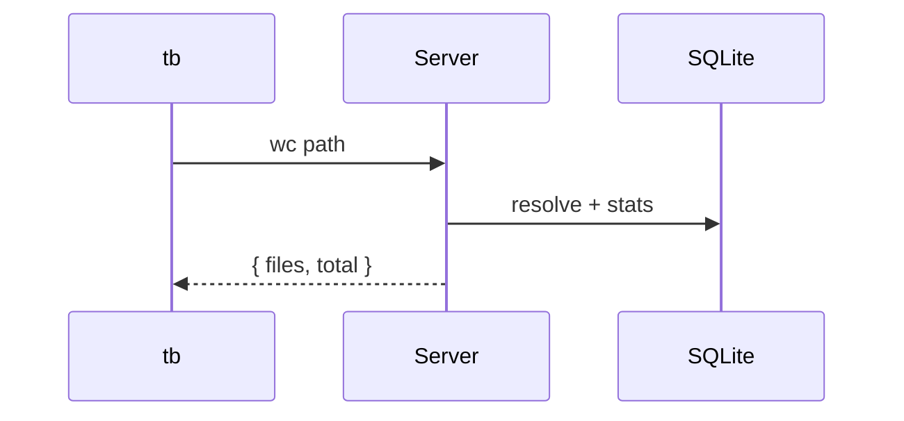

# UML / Mermaid diagrams

Tabularium Web UI renders Mermaid diagrams (including UML class and sequence) from markdown fenced blocks.

Supported fence languages:

- `mermaid`
- `uml` (alias — same Mermaid syntax)

Class diagram example:

````md
```uml
classDiagram
  class Document {
    +String path
    +String content
  }
  class Storage {
    +get(path)
    +put(path, content)
  }
  Document --> Storage
```
````

Sequence diagram example:

````md

````

Notes:

- Diagrams render in preview and chat markdown views.
- Invalid diagrams stay visible as source text with the error (page does not crash).
- Other fenced languages stay as ordinary code blocks.
